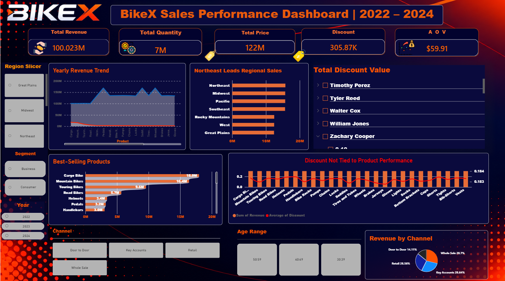
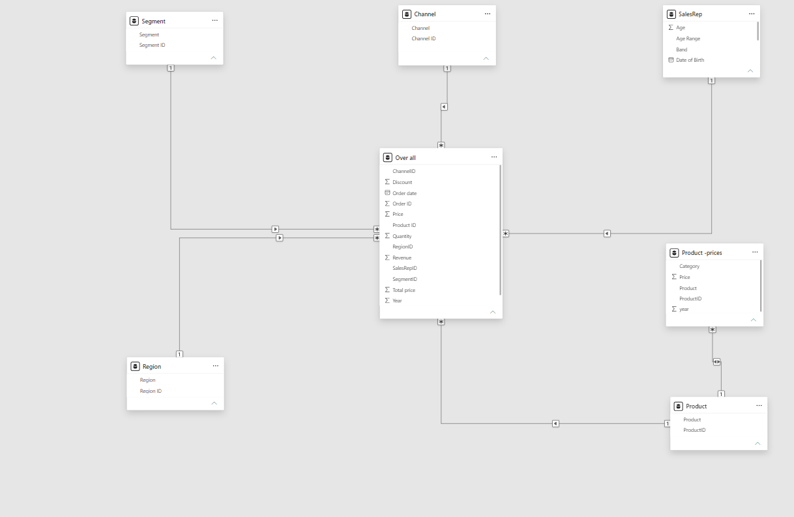

# BikeX Sales Dashboard (Power BI)

A one-page interactive sales dashboard for BikeX built on three years of sales data (2022–2024).

## Business questions

1. How much revenue does BikeX make, and how is it changing by year?
2. Which channels, products and regions bring the most revenue?
3. Which sales reps perform best?
4. Which customer segments and age ranges buy the most?
5. How much revenue goes to discounts, and what is the average order value?

## Data

Seven Excel files: yearly sales for 2022, 2023 and 2024, plus lookup files for products and prices, sales reps, regions, and channels and segments. The raw sales files (about 75 MB in total) are not included in this repository because of their size.

## Data preparation (Power Query)

- Appended the three yearly sales files into one fact table (`Over all`).
- Loaded and cleaned the lookup tables: Product, Product prices, SalesRep, Region, Channel and Segment.

## Data model

Star schema with the `Over all` sales table at the center, related to `Product`, `SalesRep`, `Channel`, `Segment` and `Region` by their IDs. `Product prices` links to `Product`.

- **Measure:** `Average Order Value` = total revenue ÷ distinct orders.

## Dashboard

One page with 5 KPI cards, a revenue trend by year, revenue by channel, product, region and sales rep, customer breakdown by segment and age range, and 6 slicers for filtering.

## Key figures

| KPI | Value |
|---|---|
| Total revenue | 100.02M |
| Units sold | 7M |
| Average order value | $59.91 |

## Findings

| Finding | Evidence |
|---|---|
| Bikes drive revenue | Cargo Bike 18.0M and Mountain Bikes 16.4M lead; the first accessory (Helmets) is 3.4M |
| No channel dominates | Wholesale 28.7%, Key Accounts 28.6%, Retail 28.6%, Door to Door 14.1% |
| Regions are close | Northeast, Midwest, Pacific and Southeast are nearly level; the other three are slightly lower |
| Discounts are flat | Average discount is about 0.18 for every product, whatever its revenue, so discounts are not targeted |

## How to open

Open `BikeX Sales Dashboard.pbip` in Power BI Desktop. Place the source Excel files in `C:\Data\BikeX\` (or update the paths in Power Query), then refresh.

## Author

**Omar Saad Abu Al-Khair**, Data Analyst · [LinkedIn](https://www.linkedin.com/in/omar-abualkhair) · [Portfolio](https://omar-abualkhair.github.io)
